# MatFlow.Studio logo guide

For an AI agent or developer placing the MatFlow.Studio brand on a website or in the app. Use the SVG files in this folder as they are. Do not redraw, retype or recolour them.

## Names

| Where | Name to use |
|---|---|
| Full product name, website, legal | MatFlow.Studio |
| Under the app icon on a phone | MatFlow |
| Tight spaces (header, sticker) | the "MatFlow." short logo |

Do not use "MF Studio" as a written name.

## The idea

- **Mat** and **Flow** are the two words in the name. The **M is red** and the **F is blue**, like the red and blue corners in combat sports. The other letters are neutral.
- A small gap sits between "Mat" and "Flow".
- The line under the name is a **belt** with a rank bar and three stripes of tape.
  - On dark backgrounds it is a **white belt**: off-white belt, black bar, white stripes.
  - On light backgrounds it is a **black belt**: black belt, red bar, white stripes.
- **.Studio** sits on a strip of tape under the belt.
- The whole logo is tilted 5 degrees upward. Keep the tilt.

## Files

| File | Use |
|---|---|
| `matflowstudio-logo-on-dark.svg` | Main logo on black or very dark backgrounds |
| `matflowstudio-logo-on-light.svg` | Main logo on white or very light backgrounds |
| `matflowstudio-logo-white-on-colour.svg` | All-white logo for red, blue or photo backgrounds |
| `matflow-short-on-dark.svg`, `matflow-short-on-light.svg` | Short logo "MatFlow." with the red dot |
| `matflow-short-small-on-dark.svg`, `matflow-short-small-on-light.svg` | Short logo with a plain bar (no stripes), for small sizes |
| `app-icon-mf-studio.svg` | App icon: MF with the STUDIO patch, rounded corners |
| `app-icon-mf-studio-square.svg` | Same icon with square corners, for app stores that round it themselves |
| `app-icon-mf-plain.svg`, `favicon.svg` | Plain MF for small sizes and browser tabs |
| `png/` | PNG exports of the above, including `app-icon-1024.png`, `apple-touch-icon-180.png`, `favicon-32.png` |
| `preview.png` | Brand sheet showing everything together |

All SVGs have transparent backgrounds except the app icons, which include their black tile.

## Which file at which size

| Space available (logo width) | Use |
|---|---|
| 320 px and wider | Main logo |
| 140 to 319 px | Short logo "MatFlow." |
| 90 to 139 px | Short logo, small version (plain bar) |
| Below 90 px, or square spaces | MF icon |

App icon: use the STUDIO patch version at 64 px and above, plain MF below that.

## Colours

| Name | Hex | Used for |
|---|---|---|
| Red | `#DB4A3E` | The M, the dot, the bar on the black belt |
| Blue | `#3F68D8` | The F, buttons and links |
| Off-white | `#F3F0E9` | Lettering and belt on dark |
| Black | `#111111` | Background, lettering and belt on light |

Backgrounds that work: black `#111111`, charcoal, white, off-white. On red, blue or photos use the all-white logo only.

## Lettering

- Logo: Permanent Marker (Google Fonts, Apache licence), converted to outlines in the SVGs.
- Icon and headings: Protest Strike (Google Fonts, Open Font Licence).
- Body text on the site: any clean sans-serif, for example Inter.

The logo files contain no live text, so no font needs to load for them.

## Rules

1. Leave clear space around the logo equal to the height of the letter M.
2. Do not straighten the tilt, stretch the logo, or change its colours.
3. Do not put the dark logo on a light background or the light logo on a dark one.
4. Do not swap the belt colours between versions.
5. Do not rebuild the logo from fonts in HTML or CSS. Always use the SVG.
6. Give the image the alt text "MatFlow.Studio".

## HTML examples

```html
<!-- Header on a dark site -->
<a href="/" aria-label="MatFlow.Studio home">
  
</a>

<!-- Icons -->
<link rel="icon" type="image/svg+xml" href="/brand/favicon.svg">
<link rel="icon" type="image/png" sizes="32x32" href="/brand/png/favicon-32.png">
<link rel="apple-touch-icon" href="/brand/png/apple-touch-icon-180.png">
```

## Changed in this repository

The three dark files (`matflowstudio-logo-on-dark.svg`, `matflow-short-on-dark.svg`, `matflow-short-small-on-dark.svg`) differ from the original kit in one place, at the owner's request (23 Nov 2026): the black bar on the belt is cut out of the belt, where the kit painted a near-black rectangle over it, and it keeps a hairline off-white edge along its top and bottom. Lettering, stripes, colours and proportions are the kit's. The light and all-white files are untouched.

## Not done

- No trademark search has been carried out on the name or the logo.
- "MF" can be read as a swear-word abbreviation. It is used only as an icon, never as a spoken or written name.
